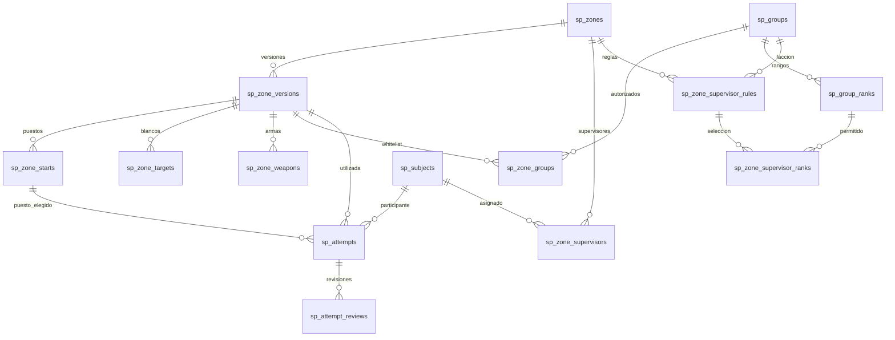

# Propuesta SQL para zonas de prácticas de tiro

Fecha: 2026-10-12. Estado: modelo SQL actualizado al MVP y funciones de integración conectadas
al flujo actual. El backend SQL y las identidades/permisos del servidor principal siguen pendientes.
El [DDL propuesto](sql/shooting-practice.sql) no es una migración aplicada ni activa un backend SQL.
El registro de múltiples zonas y hasta diez puntos de inicio por zona y su guardado en archivo v9 están implementados. Todas las zonas
actuales son públicas y los resultados siguen sin historial persistente. Las reglas de acceso,
identidad y supervisión de este documento corresponden a la integración futura.

El DDL actualizado incorpora `sp_zone_starts`, hasta diez puestos por versión, y
`sp_attempts.start_point_id` con una clave foránea compuesta que exige la misma versión.
La opción `start_indicators_enabled` se guarda por versión y afecta a todos sus puestos.
Las funciones de integración del módulo usan el archivo v9. La resolución de identidad y el
registro de evaluaciones devuelven explícitamente que no están disponibles.

Para revisar la entrega actual, consulta el [resumen de la PR](shooting-practice-pr.md) y la
[documentación del sistema](shooting-practice-mvp.md). La
[demostración del MVP](https://www.youtube.com/watch?v=cpVQbs0igC8) acompaña el funcionamiento del prototipo,
sin implicar que el backend SQL, las facciones o el historial estén implementados.

## Alcance acordado

- Solo administradores pueden crear, configurar, activar, desactivar y archivar zonas.
  RCON sigue siendo el adaptador de administración del servidor de pruebas.
- `/practicaconfig` abrirá un listado de zonas con ID, nombre, estado, modo de acceso y evaluaciones habilitadas.
  `/practicaconfig <id>` abrirá directamente la configuración de esa zona.
  Ambos caminos y las respuestas de diálogos comprueban el permiso administrativo.
- Cada zona tiene hasta diez puntos de inicio en el mismo interior/mundo, diez blancos y reglas propias.
  Sus puestos comparten blancos y admiten una sola práctica activa por zona.
  Distintas zonas pueden funcionar simultáneamente. Cada jugador participa en una sola ronda.
- Solo hay dos modos de acceso: **libre** y **restringido**. En el restringido, una whitelist
  permite uno o varios grupos/facciones. Basta pertenecer a uno de ellos. No hay whitelist individual.
- Una zona restringida sin grupos permitidos o sin identidad/pertenencia resoluble no permite iniciar.
  En modo libre no se exige pertenecer a un grupo; su whitelist se guarda vacía.
- La supervisión del historial es futura. Consultar o comentar prácticas no concede permiso para
  configurar zonas ni acceso para practicar en una zona restringida.
- Su modelo contempla asignaciones individuales para toda una zona y reglas por facción/grupo
  con rango mínimo o selección de rangos. Solo administradores pueden concederlas o revocarlas.

## Entrenamiento, evaluación e historial configurable

Se propone separar el propósito de la ronda de quién puede entrar en la zona:

| Comando propuesto | Propósito | Historial |
| --- | --- | --- |
| `/practica` | Entrenamiento con resumen privado y veredicto orientativo. | No crea un intento ni detalle persistente, aunque la zona permita evaluaciones. |
| `/evaluaciontiro` | Intento evaluado con resultado consultable por personal autorizado. | Registra inicio, cierre y detalle; conserva aprobaciones, reprobaciones e interrupciones. |

Los dos comandos utilizan el mismo motor: blancos, armas, tiempos, secuencia y puntuación de la
zona. Comparten autorización de acceso, selección por proximidad, ocupación y limpieza.
El propósito `training` o `evaluation` se fija en la sesión antes de iniciar; no se puede convertir
un entrenamiento en evaluación después de conocer su resultado. La interfaz avisa al participante
si la ronda queda registrada. El resultado de entrenamiento puede mostrar la misma puntuación y
un veredicto orientativo, pero debe identificarse como entrenamiento sin registro.

Cada versión tiene `history_policy`, configurable exclusivamente por administradores:

- `none` (valor inicial): permite entrenamientos; rechaza `/evaluaciontiro` y no genera historial.
- `evaluations_only`: permite entrenamientos sin registro y evaluaciones registradas.

No es un tercer modo de acceso. Una zona recreativa puede ser libre con `none`; una academia LSSD
puede restringirse a LSSD con `evaluations_only`. También se permiten las combinaciones libre con
evaluaciones o restringido sin historial. Habilitar historial no requiere pertenecer a una facción,
pero toda evaluación sí necesita una identidad persistente resoluble.

`sp_attempts` y sus detalles contienen exclusivamente evaluaciones registradas. No hacen falta una
tabla de entrenamientos ni una columna `save_history` por intento: para cada evaluación el servicio
valida la política de la versión utilizada y crea el registro. Los entrenamientos y las rondas nuevas
en zonas sin historial no generan filas de intentos, grupos de admisión ni blancos ejecutados.
Este contrato se cumple en el servicio; el FK a una versión no verifica por sí solo su política.

La política se congela junto con las reglas al iniciar. Deshabilitar evaluaciones en una versión
nueva impide nuevas evaluaciones, sin borrar ni ocultar las anteriores a supervisores autorizados.
Las consultas y revisiones de evaluaciones anteriores conservan su autorización propia.
No se podrá alternar el registro durante una ronda ni guardar solo resultados aprobados.
La primera versión no añade modo de examen obligatorio, límite de intentos, período de espera,
asistencia de instructor ni certificaciones; se podrán evaluar esas extensiones después.

## Estructura propuesta

Los nombres usan el prefijo `sp_`. Las dieciséis tablas separan referencias externas, configuración,
historial y supervisión. Sus funciones pueden incorporarse por etapas.

| Tabla | Qué representa | Relaciones principales |
| --- | --- | --- |
| `sp_subjects` | Referencia estable a un jugador/actor del servidor principal. | Fuente + ID externo únicos; utilizada por participantes, administradores y supervisores. |
| `sp_groups` | Referencia a un grupo o facción existente. | Fuente + tipo + ID externo únicos. No almacena miembros ni crea facciones. |
| `sp_group_ranks` | Referencia a un rango externo de un grupo/facción. | Grupo + ID externo únicos; no almacena miembros ni define jerarquías propias. |
| `sp_zones` | Identidad estable de una zona y su estado operativo. | Apunta a su versión vigente; conserva creador y fecha de archivo. |
| `sp_zone_versions` | Configuración de una zona en un momento concreto. | Zona, número de versión, nombre, dimensión compartida, pickup activado/desactivado, tiempos, criterios, aleatoriedad, acceso e historial. |
| `sp_zone_starts` | Puestos de inicio de una versión. | Orden del 1 al 10, nombre opcional, posición y orientación. ID propio y pertenencia a una versión. |
| `sp_zone_targets` | Blancos de una versión de configuración. | Una fila por blanco: orden, nombre, modelo, comportamiento, posición y rotación. |
| `sp_zone_weapons` | Armas permitidas en una versión. | Relación versión–arma, sin máscaras de bits ni listas de texto. |
| `sp_zone_groups` | Whitelist de una versión. | Relación versión–grupo/facción; evita duplicados. |
| `sp_attempts` | Una evaluación registrada, en curso, completa o interrumpida. | Participante, versión y puesto elegido, fechas, contadores, motivo y evaluación automática. |
| `sp_attempt_groups` | Grupos de la whitelist que autorizaron la entrada en esa evaluación. | Conserva el contexto de admisión aunque después cambie la pertenencia. |
| `sp_attempt_targets` | Secuencia de la evaluación y resolución de cada blanco. | Detalle consultable; vincula posiciones y estímulos a la misma versión, sin guardar un evento por disparo. |
| `sp_zone_supervisors` | Asignaciones individuales para consultar toda una zona. | Zona–persona; `can_review` permite añadir observaciones. Son concesiones explícitas de administradores. |
| `sp_zone_supervisor_rules` | Reglas vigentes de supervisión por zona y grupo/facción. | Una por zona–grupo: rango mínimo o selección de rangos, permiso de observaciones y revocación. |
| `sp_zone_supervisor_ranks` | Rangos exactos permitidos por una regla de selección. | Relaciona regla y rangos del mismo grupo; no aplica al modo de rango mínimo. |
| `sp_attempt_reviews` | Observaciones posteriores de un supervisor. | Evaluación, autor, fecha, observación y estado de seguimiento; no modifica la nota automática. |

Las tablas de identidad son puentes, no un sistema nuevo de cuentas. Si el servidor principal
ofrece tablas comunes apropiadas, se pueden sustituir por claves foráneas directas durante la
integración. Si facciones y grupos viven en estructuras distintas, el puente permite referenciarlos
con integridad sin usar columnas ambiguas como `group_or_faction_id` ni depender de sus nombres.
Para roleplay, la identidad participante debería corresponder al personaje si la pertenencia a
facciones es por personaje. La fuente concreta determina ese contrato.



## Versiones que conservan el significado del historial

`sp_zones.id` es el ID que verá el administrador. No cambia al editar la zona.
`sp_zone_versions.id` identifica una configuración concreta y su `version_number` crece dentro
de esa zona. Nombre, puestos, geometría de blancos, indicador de inicio, reglas, armas, whitelist e historial pertenecen a esa versión.

Cada guardado confirmado crea una versión nueva con sus puestos, blancos, armas y grupos dentro de una
transacción. Después se cambia el puntero de la zona a esa versión. Los borradores del editor no
se guardan como versiones. Una configuración parcial puede conservarse, pero la zona permanece
desactivada hasta cumplir las condiciones necesarias para practicar.

Una versión que ya es vigente o aparece en el historial es inmutable. El servicio debe impedir
actualizar o eliminar sus filas y sus relaciones. Las claves foráneas protegen referencias, pero
no implementan por sí solas esta regla de inmutabilidad. Se pueden retirar físicamente borradores
no publicados mediante un proceso explícito; no se borran versiones históricas por cascada.

Para publicar, el servicio bloquea la fila de la zona o comprueba su versión esperada antes de
cambiar el puntero. Esto evita que dos guardados sobrescriban silenciosamente el trabajo del otro.
La clave foránea compuesta impide seleccionar como vigente una versión de otra zona.

Cada evaluación guarda `zone_version_id`, por lo que cambiar luego el puntaje mínimo de 5 a 8
no transforma una evaluación aprobada anteriormente en reprobada. Cambiar una facción autorizada
tampoco reescribe quién tuvo acceso a las evaluaciones pasadas. El nombre anterior de la zona
permanece disponible en la versión histórica.

## Correspondencia con la configuración actual

- Hasta diez puestos y diez blancos por versión. `sort_order` acepta del 1 al 10 y es único dentro
  de cada versión. Los huecos se conservan. Al cargar un puesto se usa
  `PracticeStartSlot(sort_order - 1)`. El índice Pawn no es una identidad SQL.
- Nombre de zona de hasta 48 caracteres y nombres opcionales de puestos/blancos de hasta 32.
  Las validaciones del módulo siguen comprobando caracteres admitidos y representación para el cliente.
- Posiciones XYZ entre -20000 y 20000. Orientaciones normalizadas en grados con seis decimales.
  Un ángulo legado de 360 se normaliza a 0 al importar.
- Interior y mundo pertenecen a la versión y se comparten entre sus puestos/blancos.
  El servicio valida blancos a 3-100 metros de cada puesto y la separación de nuevos puestos.
  Radios de inicio de 1.5 metros y abandono de 3 metros congelados como constantes del MVP.
  Una configuración parcial o con geometría incompleta se conserva inactiva.
- Indicadores desactivados por defecto. Al activarlos se crea una pistola decorativa en cada
  puesto. Modelo 348, tipo 1 y desplazamiento Z -0.65 siguen siendo constantes del código,
  no nuevas opciones por puesto. No se guardan handles de pickups, etiquetas ni checkpoints.
- Una fila por arma permitida, IDs 22-34. Preparación de 1000-30000 ms en segundos enteros,
  exposición de 100-60000 ms e intervalo de 0-30000 ms en pasos de 100 ms.
  Puntaje mínimo del 1 al 10 y errores máximos del 0 al 10.
- Los modelos se guardan por ID. El catálogo actual tiene 1271, 1583-1586, 1543, 1544, 2601 y 1238.
  Su categoría y su vista en el selector se derivan del catálogo. El SQL admite IDs propios con signo,
  pero el servicio debe validar que el modelo esté disponible antes de activarlo.
- El acceso inicial del SQL es `open` y el historial `none`, igual que el MVP de archivo.
  El backend futuro validará las zonas restringidas y su whitelist antes de habilitar su uso.

El DDL es una definición para una BD vacía, no un ALTER automático sobre un servidor existente.
Para importar un modelo anterior con un inicio, se crea la fila de puesto con orden 1 y se deja
el indicador desactivado. Las identidades de autores deberán resolverse con el servidor principal.

## Acceso y referencias externas

La autorización de práctica es:

```text
zona activada y no archivada
    y (modo libre
       o intersección no vacía entre whitelist y grupos/facciones actuales del participante)
```

Identidad, grupos actuales y privilegios administrativos proceden del servidor principal y se
consultan mediante adaptadores sobre datos cargados en memoria. El módulo no mantiene una copia
propia de la membresía, no interpreta el nombre del jugador y no consulta SQL por cada disparo.
Un grupo externo eliminado/inactivo no debe seguir concediendo acceso por un registro antiguo.
Al iniciar se comprueba la pertenencia actual; si el servidor principal comunica una pérdida de
acceso durante la ronda, esta se interrumpe. En evaluaciones registradas el contexto de admisión
inicial permanece en el historial; un entrenamiento sigue sin crear registros.

En una evaluación restringida, `sp_attempt_groups` conserva todos los grupos permitidos que
coincidían al iniciar, no una elección arbitraria de una facción. En una evaluación libre queda vacío.
Ese registro explica la admisión histórica; no concede acceso futuro ni sustituye la membresía real.

No hay permisos administrativos en la whitelist. El creador registrado de una zona tampoco recibe
privilegios por ser creador. La autoridad administrativa siempre viene del servidor principal.

## Resultados y revisión futura

`sp_attempts` usa una clave única de intento para que un reintento de escritura no duplique la
evaluación. Distingue `in_progress`, `completed` e `interrupted`. Registra inicio/fin en UTC,
motivo de interrupción, versión del algoritmo de puntuación y nombre visible al iniciar.
La identidad estable es el FK del participante. El nombre es solo una referencia histórica.
`start_point_id` pertenece obligatoriamente a `zone_version_id`. La fila de puesto conserva su
nombre, posición y orientación históricos. Cambiar de caseta, renombrarla o borrarla en una versión
nueva no altera el origen de una evaluación anterior.
`interruption_reason` guarda un código estable y `interruption_message` conserva por separado
la explicación traducida de hasta 144 caracteres. No se usa el texto del chat como código.
El cierre se acepta una sola vez desde `in_progress`; un reintento no reevalúa ni sobrescribe
una evaluación que ya quedó cerrada.

Los contadores registran disparos, aciertos, blancos de tiro agotados, protegidos respetados y
errores de identificación. El puntaje y el veredicto son la evaluación automática registrada.
Esta pequeña desnormalización permite conservar la evaluación original si cambia el algoritmo;
el servicio comprueba su coherencia con los contadores y las reglas congeladas.
La precisión se calcula como `100 * hit_count / shots_fired`; con cero disparos queda sin valor.
El tiempo total se deriva de las fechas. No se guarda un porcentaje redondeado como otro resultado.

Las evaluaciones interrumpidas conservan contadores y puntaje parcial, pero `passed` es `NULL`.
Solo una evaluación completa lleva `passed = 1` o `0`. Cancelar, desconectarse o perder el acceso
no permite hacer desaparecer el intento del historial. Un reinicio inesperado podrá cerrar intentos
que quedaron `in_progress` con un motivo de recuperación, sin inventar blancos vistos ni un veredicto.
El guardado de inicio/cierre y sus detalles se hará por transacciones, sin SQL dentro del flujo
de disparos.

Una evaluación no inicia su cuenta atrás hasta confirmar el registro duradero del inicio y su
contexto. Si el backend o la identidad no están disponibles, se rechaza ese inicio con un motivo;
no se convierte automáticamente en entrenamiento. Mientras se espera el registro, la reserva y
los callbacks deben seguir ligados al jugador conectado y a la zona/versión originales.
Si falla la escritura del cierre, se libera la zona y se muestra el resultado local indicando
que el guardado está pendiente o falló, sin anunciar que quedó registrado. Se necesita conservar
el cierre para reintento duradero e idempotente antes de descartar su snapshot; el mecanismo concreto
(por ejemplo, una cola duradera) se definirá al integrar el backend. Recuperar solo la fila de inicio
permite señalar una interrupción, pero no reconstruye resultados finales que no llegaron a guardarse.

El detalle de blancos conserva la secuencia realmente utilizada. Una referencia indica qué
posición/rotación se usó y otra qué modelo/comportamiento apareció allí. Esto representa la
distribución aleatoria sin copiar todos los atributos del blanco ni perder su configuración original.
`zone_version_id` se repite en estas relaciones y en el contexto de admisión para que claves
foráneas compuestas impidan mezclar datos de versiones diferentes: es redundancia controlada
para integridad. No se obliga en SQL a que una posición aparezca solo una vez, permitiendo
ejercicios futuros con repeticiones; la primera versión del motor mantiene una aparición por posición.
Las posiciones planeadas pero nunca mostradas conservan fechas y resolución nulas.

Un supervisor ve las evaluaciones registradas para las que tiene autorización vigente:
participante, fecha, estado, disparos, aciertos, precisión, errores, puntaje/veredicto,
duración y resolución por blanco. No ve entrenamientos porque no quedan registrados.
Una asignación individual permite consultar toda la zona; una regla de facción limita la consulta
a los intentos cuyo contexto de admisión incluye esa facción. Esa restricción se aplica en las
consultas y sus totales, antes de paginar o mostrar resultados; no es un filtro opcional del cliente.

`can_review` permite agregar observaciones. Las revisiones son anotaciones fechadas y no sustituyen
el resultado automático ni certifican un FTP. Revocar una asignación impide consultas/revisiones
nuevas, sin borrar observaciones anteriores. Solo administradores pueden conceder o revocar asignaciones.
Las revisiones se agregan a intentos cerrados. Archivar o desactivar la zona impide nuevas prácticas,
pero no elimina el acceso al historial de un supervisor que conserva su asignación.

### Supervisión por facción y rango

El DDL contempla asignaciones individuales mediante `sp_zone_supervisors`, con alcance a toda la
zona, y reglas por zona y grupo/facción mediante `sp_zone_supervisor_rules`. Toda concesión permite
consultar dentro de su alcance; `can_review = 1` permite además añadir observaciones dentro del
mismo alcance. La autorización en el motor y la interfaz de consulta siguen pendientes.

Por ejemplo, el administrador podría configurar en la zona Academia LSSD: «miembros actuales de
LSSD, rango Sargento o superior, pueden consultar evaluaciones de LSSD». Sargento es un ejemplo,
no un rango fijo del módulo. Los roles o permisos específicos de instructor/FTO se consideran
una extensión posterior. La base cubre rangos y asignaciones individuales sin exigir ese servicio.

Las reglas deben separar tres capacidades:

- Configurar zonas y conceder permisos: exclusivamente administradores del servidor principal.
- Consultar resultados: miembros que cumplan una regla vigente o una asignación individual vigente.
- Añadir observaciones: requiere permiso adicional; nunca cambia la puntuación automática.

Las concesiones son aditivas: basta una autorización vigente con alcance al intento. Un permiso
de consulta global no extiende un permiso de observaciones que solo cubra una facción. Ser creador
de la zona, participante autorizado o administrador que puede configurar no sustituye una concesión
de supervisión para las consultas del módulo; los administradores pueden concederse una asignación
explícita si necesitan revisar toda una zona. Un sujeto desactivado/no resoluble no recibe acceso.

La pertenencia y el rango para una regla se consultan al acceder al historial y al añadir una
observación, usando datos actuales del servidor principal. No se congelan como autorización del
supervisor al iniciar una evaluación. Una baja o degradación que deje de cumplir el rango mínimo
retira el acceso concedido por esa regla. Si también existe una asignación individual, esta conserva
su alcance hasta su revocación: es un permiso independiente que debe ser visible al administrador.
Los datos no disponibles o un rango sin resolver no conceden acceso por la regla. Un grupo inactivo
o un rango actual/referenciado inactivo tampoco cumplen la regla. Las asignaciones individuales
no exigen rango ni pertenencia: su independencia es explícita, no una excepción oculta.

Cada zona/grupo tiene como máximo una regla vigente, con uno de estos criterios:

| `rank_mode` | Datos de la regla | Cómo se comprueba |
| --- | --- | --- |
| `minimum` | `minimum_rank_id` obligatorio; sin filas de selección. | El rango actual es el mínimo configurado o superior, según la jerarquía real del grupo. |
| `selected` | `minimum_rank_id` nulo; una o varias filas en `sp_zone_supervisor_ranks`. | El rango actual coincide exactamente con un rango seleccionado; no incluye superiores automáticamente. |

Una selección vacía no concede acceso a nadie y no se publica como una regla completa. El guardado
de la regla y la selección se realiza en una transacción. El FK compuesto impide que un rango
pertenezca a otra facción. El discriminador `rank_mode` de las filas de selección, siempre `selected`,
es redundancia controlada para impedir por FK agregar una selección a una regla de rango mínimo.
Cambiar de criterio exige ajustar/eliminar esas filas dentro de la misma transacción.

El adaptador compara rangos según la jerarquía real de la facción. No puede asumir que un ID numérico
mayor implica más autoridad, ni interpretar etiquetas como "Sargento". Si la fuente no permite
resolver esa comparación, el modo `minimum` no concede acceso; el administrador puede configurar
`selected` en su lugar. Cada facción mantiene su propio catálogo y jerarquía. `can_review` aplica
a todos los miembros que cumplen la regla; umbrales distintos para consulta y observaciones quedan
fuera de esta primera versión.

En zonas compartidas, la regla por facción tendría alcance a los intentos cuyo contexto de admisión
`sp_attempt_groups` incluya esa facción. Cambiar después de facción al participante no mueve sus
evaluaciones anteriores al historial de la nueva facción. Ver toda la zona requiere una asignación
explícita con ese alcance; pertenecer a la whitelist de participantes no concede lectura.
Un intento libre no tiene grupo de admisión y no queda cubierto por esta regla de facción;
consultarlo requiere una asignación con alcance a toda la zona. No se infiere la facción histórica
a partir de la pertenencia actual del participante.

`sp_group_ranks` referencia rangos externos dentro del grupo que los proporciona. No mantiene
cuentas, miembros ni una copia propia de privilegios o del orden jerárquico. Las reglas son vigentes
y revocables; no forman parte de las versiones inmutables del ejercicio ni dependen de la whitelist
actual. Quitar una facción de la whitelist impide nuevas entradas por ella, pero no revoca por sí
solo la supervisión de sus evaluaciones antiguas. Revocar una regla/asignación no borra resultados
ni observaciones anteriores. El modelo guarda el estado vigente de las concesiones; una auditoría
completa de todos sus cambios no forma parte de esta versión.

El contrato de consulta por intento es:

```text
identidad actual válida
    y (asignación individual vigente para toda la zona
       o (regla vigente de esa zona y grupo
           y pertenencia/rango actuales cumplen el criterio
           y el intento conserva ese grupo en su contexto de admisión))
```

Para añadir observaciones se exige además un intento cerrado y `can_review = 1` en una concesión
que cubra ese mismo intento. El servicio revalida todo al escribir, incluso si un diálogo ya estaba
abierto cuando se revocó el permiso. No se conserva acceso por un listado previamente abierto.

## Integridad, límites y operación

- InnoDB, claves foráneas, claves únicas e índices por zona/versión, participante/fecha y grupo/intento.
  El DDL de referencia usa `CHECK` de MySQL 8.0.16 o posterior; no se presupone la versión productiva.
- Dos modos de acceso y dos políticas de historial independientes, comportamientos y estados válidos,
  tiempos y límites del MVP, coordenadas de puestos válidas, órdenes de puestos/blancos únicos y ningún
  veredicto para evaluaciones interrumpidas.
- Se archivan zonas y referencias externas; eliminar una zona desde el menú significa archivar.
  El historial sigue consultable por personal autorizado. Desactivar impide nuevas prácticas.
- Hasta diez blancos por zona y las restricciones actuales de armas/tiempos/distancia se validan
  en la aplicación. El esquema no tiene diez columnas ni restricciones vinculadas al catálogo provisional.
  Las unidades son metros, grados, milisegundos y fechas UTC, independientemente de Pawn.
- `model_id` admite valores con signo para conservar la posibilidad de usar objetos propios
  de SA-MP 0.3.DL. El registro/descarga de esos recursos y su selección quedan para otra fase.
- Los IDs SQL son `BIGINT UNSIGNED`. Pawn usa celdas de 32 bits: el adaptador debe conservar IDs
  como texto/mapearlos a índices internos, sin truncarlos ni confundir índices con IDs persistentes.
- El DDL no fuerza reglas entre varias tablas como whitelist vacía en modo libre, whitelist no vacía
  al activar una zona restringida, elegibilidad de una versión para registrar evaluaciones,
  selección de rangos no vacía al publicar una regla, coherencia global de resultados o permisos
  actuales del autor de una revisión.
  Esas reglas son obligatorias en el servicio y sus transacciones, no se dan por cubiertas por un FK.
- Estado de ocupación, objetos dinámicos, handles de UI, borradores y temporizadores viven en memoria.
  No se serializan como columnas SQL. Un fallo al registrar el historial no puede impedir la limpieza
  ni dejar al jugador ocupando una zona indefinidamente.

## Integración por etapas

1. Revisar este modelo y resolver los IDs/fuentes reales de personajes, grupos/facciones y administradores.
2. Registro de múltiples zonas, listado administrativo y acceso directo por ID: implementados
   el 2026-10-08 con sesiones/edición independientes y archivo v7. Todas las zonas actuales son públicas.
3. Implementar libre/restringido y selección de grupos/facciones mediante el adaptador de membresía.
4. Mantener el archivo como backend inicial o conectar SQL mediante la capa de almacenamiento.
   El backend de archivo v9 migra los formatos 1-6 a una zona #1 pública y conserva las zonas/puestos de v7-v8.
   No se harán escrituras dobles archivo/BD automáticamente. El DDL sigue siendo una propuesta sin conexión runtime.
5. Incorporar la política de historial y `/evaluaciontiro` con registro fiable de inicio/cierre/detalle;
   mantener `/practica` sin historial. Conectar después reglas/asignaciones y consultas/revisiones
   de supervisores con comprobación de alcance por intento.

Este diseño no introduce listas individuales de usuarios, un sistema propio de cuentas/facciones,
plantillas compartidas de ejercicios, clasificación pública, recompensas ni certificaciones.
La exclusión de listas individuales se refiere al acceso para practicar; las asignaciones individuales
de supervisores son permisos separados y sí están contempladas.
Esas extensiones pueden añadirse con tablas/relaciones específicas cuando exista un caso concreto.

## Funciones de integración conectadas

El nuevo `gamemodes/features/shooting_practice/integration.inc` centraliza las implementaciones
actuales y los puntos marcados `TODO(SP-DB-...)`. Las funciones se llaman desde el flujo real,
y no ejecutan SQL ni abren conexiones.

| Función | Punto de llamada actual | Contrato |
| --- | --- | --- |
| `PracticeHostIsAdministrator` | `PracticeIsAdministrator` | Política RCON actual. Se sustituirá por el rol administrativo del host. |
| `PracticeHostCanUseZone` | `PracticeCanUseStation` | Acceso público actual. La futura whitelist usa membresía cargada en memoria. |
| `PracticeHostResolveSubject` | Puerta de futura evaluación | Devuelve falso y una clave vacía. No inventa identidades con playerid o nickname. |
| `PracticeRepositoryLoad` | Bootstrap del repositorio | Carga y valida archivo v9. El SQL deberá cargar versiones, puestos, indicadores y relaciones en registros temporales. |
| `PracticeRepositorySave` | `PracticeSaveAndNotify` | Guarda el archivo validado. El booleano es síncrono y exclusivo del archivo. |
| `PracticeRepositoryBootstrap` | `OnGameModeInit` | Usa el repositorio activo. En SQL esperará a la conexión compartida y a una carga validada. |
| `PracticeIntegrationBeforeStart` | Antes de cuenta atrás | Recibe propósito, origen, puesto y plan congelados. Acepta entrenamiento y rechaza evaluación hasta implementar identidad y registro duradero. |
| `PracticeIntegrationOnEnd` | `PracticeEnd`, antes de limpiar | Recibe el resultado, motivo, origen y plan aunque no se notifique al jugador. Devuelve `NOT_RECORDED` para entrenamiento y `UNAVAILABLE` para evaluación. |
| `PracticeIntegrationShutdown` | `OnGameModeExit`, antes de liberar sesiones | Ofrece las sesiones activas al puerto de cierre, sin UI/audio ni historial de entrenamiento. |

`PracticePurpose` se congela en la sesión. `/practica` lo fija en entrenamiento. No existe
un comando de evaluación operativo, un backend SQL seleccionable ni un guardado que simule éxito.
Las claves BIGINT resueltas por el host se representarán como cadenas decimales, con espacio para
20 dígitos y el terminador. Las zonas del archivo conservan sus IDs actuales.

Antes de activar evaluaciones se debe añadir el estado de espera de registro, contexto persistente
de sujeto/versión/puesto/intento, timestamps UTC y callbacks de confirmación. Una consulta en cola
no puede devolver el éxito síncrono de `PracticeRepositorySave`. Debe conservar la revisión esperada
y el solicitante, y confirmar únicamente la versión comprometida. El cierre deberá copiar sus
argumentos antes de retornar para conservarlos tras la limpieza, con reintento duradero e idempotente.
El apagado coordinado por el host debe drenar escrituras antes de cerrar la conexión compartida.

Los TODOs de funcionalidades futuras quedan identificados en `integration.inc`:

- `SP-ACCESS-UI`, junto con `SP-ACCESS`: selección de acceso libre/restringido y asignación
  de uno o varios grupos/facciones desde el panel administrativo del campo.
- `SP-SUPERVISION`: asignaciones de supervisores y reglas por facción/rango, con consultas
  y observaciones limitadas al alcance autorizado. No concede acceso para practicar ni configurar.

Estos marcadores son puntos de desarrollo futuro. No añaden menús, comandos ni permisos operativos.

## Preparación para formalizar la especificación

El dominio y las reglas principales están suficientemente definidos para redactar la especificación
funcional de la primera versión: administración de múltiples zonas, configuración/blancos/reglas,
acceso libre o whitelist de grupos, entrenamiento sin registro, evaluación con historial opcional
por zona, estados/resultados/detalle y supervisión por rango o asignación individual con alcances.
Los comandos propuestos y las responsabilidades entre administrador, participante y supervisor
también están definidos. El MVP ya implementa la administración RCON de zonas, puestos y reglas.
El acceso restringido, la evaluación registrada y la supervisión requieren la futura integración con el servidor principal.

Las siguientes dependencias técnicas se documentarán como contratos de integración; no requieren
reabrir las reglas funcionales para comenzar a formalizar el documento:

| Dependencia | Contrato que debe satisfacer la implementación |
| --- | --- |
| Identidad | Resolver un personaje/sujeto persistente y activo, independiente de nickname y `playerid`. |
| Grupos/rangos | Entregar pertenencia y rango actuales, detectar cambios y comparar jerarquías cuando se use `minimum`. |
| Administración | Un permiso central del servidor para configurar zonas y conceder/revocar supervisión. |
| Persistencia | Confirmar versiones e inicios/cierres duraderos; reintentos idempotentes y snapshots finales recuperables. |
| Entorno SQL | Verificar versión/compatibilidad real del plugin y motor antes de convertir el DDL de referencia en migraciones. |

Con el backend actual de solo archivo no se habilitan evaluaciones registradas: su inicio requiere la versión
duradera y las referencias que necesita el historial. La migración del archivo a SQL y los
límites operativos del backend SQL se concretarán al implementarlo. La migración entre formatos
anteriores y el archivo v9, junto con los límites del registro actual, ya están implementados. Los nombres definitivos
de comandos de consulta/observaciones y el detalle de sus diálogos pertenecen a la especificación
de interfaz; sus permisos, alcance y datos ya están definidos. La formalización puede comenzar
sin presentarlos como código terminado ni asumir IDs/esquemas productivos inexistentes.

## Validación del modelo actualizado: 2026-10-11

El DDL de dieciséis tablas se creó en MySQL 8.0.34, en una instancia temporal con directorio de datos
propio y puerto de loopback independiente. Pasaron **54 comprobaciones** de puestos múltiples,
órdenes escasos/unicidad/límites, nombres y posiciones, indicadores por versión, tiempos decimales,
armas, catálogo, FK del puesto elegido, rechazo de otras zonas/versiones, mensajes con tildes
y conservación del origen histórico al cambiar o archivar la zona.

Prueba reproducible: `scripts/test-shooting-practice-sql.ps1`, con
`tests/shooting_practice_schema.sql`. El runner usa la instalación de MySQL solo como ejecutable,
inicializa sus propios datos y evita los archivos de opciones/login del usuario. Detiene solo su
instancia temporal. No aplica SQL al servidor de juego ni a servicios de BD existentes.
Registro local: `.local-server/sql-tests/ffe113a930cb42b3bd265013d783f2c0/checks.log`.

Las pruebas Pawn pasaron **1291 comprobaciones sin fallos**, incluyendo las llamadas de integración,
propósito de entrenamiento, rechazo de evaluaciones sin backend, snapshot del puesto/plan antes
de limpiar, desconexión sin notificación, rechazo de inicio y persistencia real por archivo.
El gamemode completo también compila. Las reglas futuras de membresía e historial siguen sin
backend operativo. No se reinició el servidor jugable para aplicar estas funciones.

## Validaciones anteriores del borrador

En 2026-10-08 se creó el esquema en MySQL 8.0.45 dentro de una BD temporal, sin publicar puertos
ni conectar el servidor de juego. Pasaron 36 comprobaciones de relaciones, estados e historial:
versiones de otras zonas rechazadas, whitelist sin duplicados ni referencias inexistentes,
aislamiento de versiones en detalle/contexto, cierre sin veredicto para interrupciones, recuperación,
precisión derivada, claves de intento únicas y conservación del historial al archivar.
Después del ajuste de modelos con signo se recreó el DDL y pasaron cuatro comprobaciones
adicionales: las doce tablas, un modelo propio negativo, un modelo nativo positivo y rechazo del cero.
Con `history_policy` se recreó el esquema actualizado y pasaron quince comprobaciones adicionales:
política inicial sin historial, cuatro combinaciones independientes de acceso/registro, rechazo de
políticas inválidas, detalle de evaluación reprobada, interrupción sin veredicto, contexto de admisión,
conservación de historial/reglas al deshabilitar evaluaciones y consultas por asignación de supervisor.
Con las reglas de supervisión se creó nuevamente el DDL completo de quince tablas en MySQL 8.0.45
y pasaron 47 comprobaciones adicionales. Cubren pertenencia de rangos a su facción, unicidad,
criterios válidos, aislamiento entre facciones/zonas, consulta frente a observaciones, concesiones
aditivas sin ampliar su alcance, rangos sin jerarquía, selección vacía, bajas/degradaciones,
referencias inactivas, revocaciones y conservación de notas/resultados históricos.
Las consultas de admisión/supervisión son ejemplos del contrato con datos temporales del host,
no pruebas de una implementación Pawn. Todos los contenedores temporales se eliminaron.
No se aplicó una migración productiva ni se validó todavía la integración con el plugin Pawn,
identidades, membresía o autorización del servidor real.

## Referencias técnicas

- [MySQL: archivo de login aislado mediante MYSQL_TEST_LOGIN_FILE](https://dev.mysql.com/doc/refman/8.0/en/environment-variables.html).
- [MySQL: claves foráneas](https://dev.mysql.com/doc/refman/8.0/en/create-table-foreign-keys.html).
- [MySQL: restricciones CHECK](https://dev.mysql.com/doc/refman/8.0/en/create-table-check-constraints.html).
- [MariaDB: restricciones](https://mariadb.com/docs/server/reference/sql-statements/data-definition/constraint).
  La compatibilidad del DDL con MariaDB se debe comprobar contra la versión real al integrar.
- [open.mp: IDs de modelos propios en AddSimpleModel](https://open.mp/docs/scripting/functions/AddSimpleModel).
